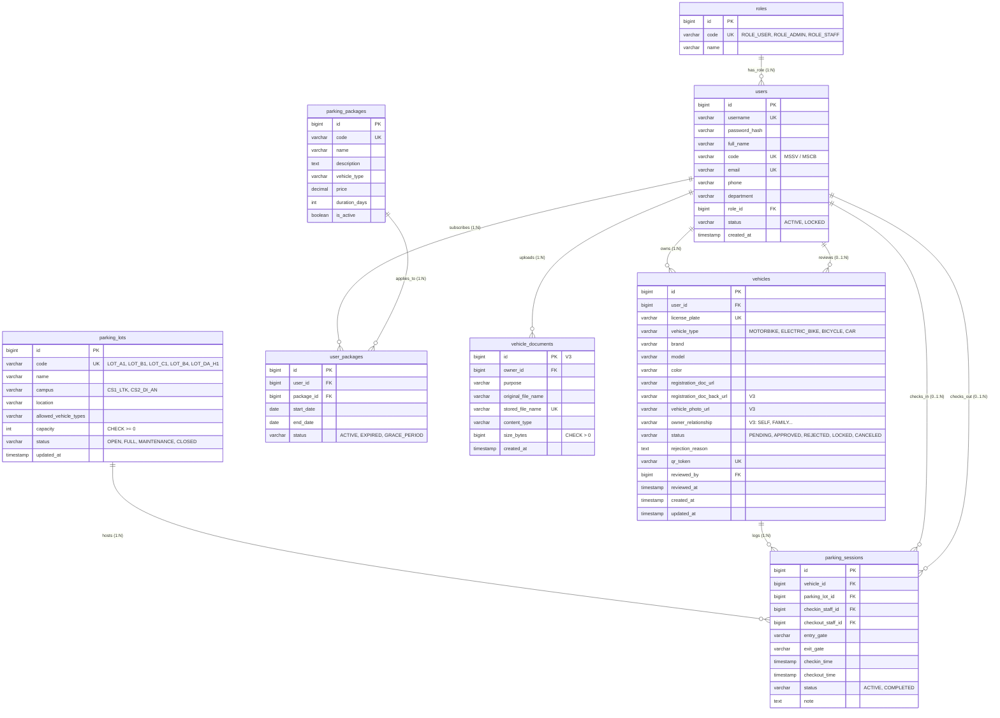

# BK Parking MVP - Kiến trúc Cơ sở dữ liệu & ERD

Tài liệu kỹ thuật nội bộ Backend - Dự án **BK Parking MVP** (CO3011 - HK261).
- **Phụ trách chính:** TV1 (Backend Lead) phối hợp TV2 (Backend Dev) và TV3 (bổ sung migration V3).
- **Hệ quản trị CSDL:** PostgreSQL 16+ (hỗ trợ H2 `MODE=PostgreSQL` cho local dev và test).
- **Flyway Migrations:** `V1__init_schema.sql`, `V2__seed_demo_data.sql`, `V3__tv3_vehicle_management_api.sql`.

---

## 1. Sơ đồ Thực thể Liên kết (Mermaid ERD)

Hệ thống gồm **8 bảng** đang chạy thực tế trên database:

---

## 2. Chi tiết các bảng và ràng buộc dữ liệu cốt lõi

### 2.1. Danh sách bảng (khớp `V1__init_schema.sql` + `V3__tv3_vehicle_management_api.sql`)
1. **`roles`**: Định nghĩa 3 vai trò `ROLE_USER`, `ROLE_ADMIN`, `ROLE_STAFF`.
2. **`users`**: Lưu thông tin tài khoản, mã định danh (`code` - MSSV/MSCB), email, khoa/đơn vị (`department`), vai trò (`role_id`) và trạng thái (`ACTIVE`/`LOCKED`).
3. **`parking_lots`**: Lưu thông tin 5 bãi đỗ (`LOT_A1`, `LOT_B1`, `LOT_C1`, `LOT_B4`, `LOT_DA_H1`), cơ sở (`campus`), loại xe cho phép (`allowed_vehicle_types` — trong `V3`, `LOT_B4` đã bổ sung thêm `CAR`), sức chứa (`capacity >= 0`) và trạng thái (`OPEN`, `FULL`, `MAINTENANCE`, `CLOSED`).
4. **`parking_packages`**: Danh mục gói đỗ xe mẫu (`PKG_SEM_261`, `PKG_MONTH_STD`, `PKG_BICYCLE_SEM`).
5. **`user_packages`**: Gán gói mẫu cho người dùng để Backend kiểm tra quyền gửi xe (`ACTIVE`) khi cấp QR hoặc quét vào cổng.
6. **`vehicles`**: Lưu thông tin phương tiện đăng ký (`license_plate` unique), trạng thái duyệt (`PENDING`, `APPROVED`, `REJECTED`, `LOCKED`, `CANCELED`), mã định danh `qr_token` (sinh khi duyệt), ảnh giấy tờ mặt trước/sau (`registration_doc_url`, `registration_doc_back_url`), ảnh xe (`vehicle_photo_url`), mối quan hệ chủ xe (`owner_relationship`) và thông tin kiểm duyệt (`reviewed_by`, `reviewed_at`, `rejection_reason`).
7. **`vehicle_documents`** *(bổ sung ở `V3`)*: Lưu metadata các file ảnh giấy tờ xe người dùng upload lên server (`stored_file_name`, `content_type`, `size_bytes`).
8. **`parking_sessions`**: Lưu lịch sử từng lượt xe vào/ra (`checkin_time`, `checkout_time`, `entry_gate`, `exit_gate`, nhân viên xác nhận và trạng thái `ACTIVE` / `COMPLETED`).

### 2.2. Các quy tắc toàn vẹn dữ liệu bắt buộc
1. **Tính số chỗ trống từ phiên đang mở (`ACTIVE`):**
   - Không lưu cột đếm rời rạc trong `parking_lots` để tránh sai lệch dữ liệu.
   - `occupiedCount` = `COUNT(*)` trong `parking_sessions` theo `parking_lot_id` với `status = 'ACTIVE'`.
   - `availableSlots` = `MAX(0, capacity - occupiedCount)`.
2. **Chống check-in trùng (Anti-passback):**
   - Trong `ParkingSessionService.checkIn` (`@Transactional`), hệ thống kiểm tra `findByVehicleIdAndStatus(vehicleId, "ACTIVE")`. Nếu xe đã có phiên đang mở thì trả về `409 Conflict` (`SESSION_ALREADY_ACTIVE`).
3. **Ràng buộc sức chứa khi Admin cập nhật bãi:**
   - Trong `ParkingLotAndDashboardController.updateParkingLot` (`@Transactional`), nếu `capacity` mới nhỏ hơn `occupiedCount` hiện tại thì từ chối với mã lỗi `400 Bad Request` (`CAPACITY_BELOW_OCCUPIED`).
4. **Giới hạn đăng ký phương tiện & trùng biển số:**
   - Mỗi tài khoản chỉ được đăng ký tối đa `2` phương tiện ở trạng thái `PENDING` hoặc `APPROVED` (`VEHICLE_LIMIT_EXCEEDED`).
   - `license_plate` được chuẩn hóa viết hoa và kiểm tra duy nhất (`DUPLICATE_LICENSE_PLATE`).
5. **Index tối ưu truy vấn (`V1` & `V3`):**
   - `idx_vehicles_user_id` trên `vehicles(user_id)`
   - `idx_vehicles_status` trên `vehicles(status)`
   - `idx_sessions_vehicle_status` trên `parking_sessions(vehicle_id, status)`
   - `idx_sessions_lot_status` trên `parking_sessions(parking_lot_id, status)`
   - `idx_vehicle_documents_owner_id` trên `vehicle_documents(owner_id)`
