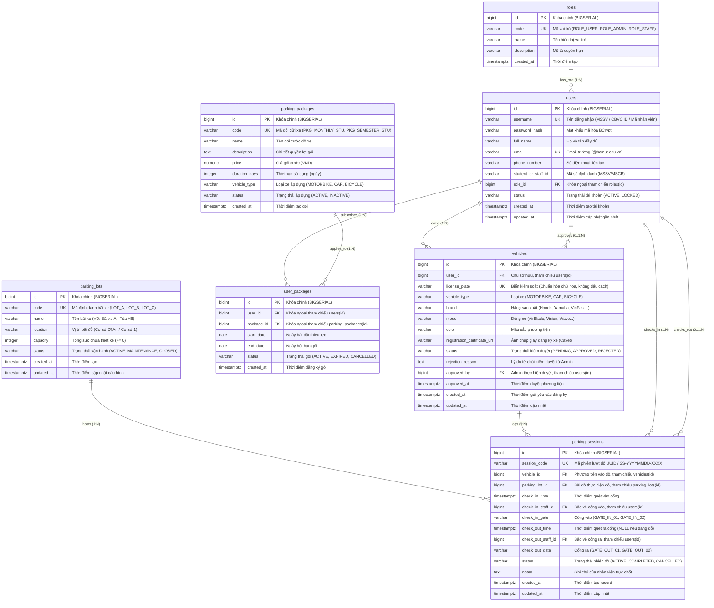

# 📐 BK PARKING MVP - KIẾN TRÚC CƠ SỞ DỮ LIỆU & ERD

> **Tài liệu kỹ thuật nội bộ Backend - Dự án BK Parking MVP (CO3011)**  
> **Người biên soạn:** TV1 (Backend Lead / Nền tảng chung)  
> **Người phối hợp thực hiện:** TV2 (Backend Developer / Nghiệp vụ MVP)  
> **Đối tượng sử dụng:** Toàn bộ thành viên dự án (TV1, TV2, TV3, TV4, TV5)  
> **Hệ quản trị CSDL:** PostgreSQL 16+ (Hỗ trợ H2 Database cho Unit Test & Local Dev)  
> **Công cụ quản lý Schema:** Flyway Migration (`V1__init_schema.sql`, `V2__seed_mvp_data.sql`)  

---

## 1. SƠ ĐỒ THỰC THỂ LIÊN KẾT (MERMAID ERD)

Hệ thống cơ sở dữ liệu BK Parking MVP được chuẩn hóa theo chuẩn **3NF (Third Normal Form)** gồm 7 bảng cốt lõi phục vụ đầy đủ các luồng nghiệp vụ liên Portal (User Portal, Admin Portal, Staff Portal và Public View).



---

## 2. ĐẶC TẢ CHI TIẾT TỪNG BẢNG & TRƯỜNG DỮ LIỆU

### 2.1. Bảng `roles` (Vai trò người dùng)
Quản lý 3 nhóm đối tượng truy cập chính trong hệ thống BK Parking.

| Tên cột | Kiểu dữ liệu | Ràng buộc | Mô tả & Giá trị mẫu |
| :--- | :--- | :--- | :--- |
| `id` | `BIGSERIAL` | `PRIMARY KEY` | Định danh tự tăng. |
| `code` | `VARCHAR(32)` | `NOT NULL, UNIQUE` | Mã vai trò: `'ROLE_USER'`, `'ROLE_ADMIN'`, `'ROLE_STAFF'`. |
| `name` | `VARCHAR(100)` | `NOT NULL` | Tên vai trò: `Người dùng (SV/CBVC)`, `Quản trị viên`, `Nhân viên bảo vệ`. |
| `description` | `VARCHAR(255)` | `NULL` | Quyền hạn và phạm vi sử dụng. |
| `created_at` | `TIMESTAMPTZ` | `NOT NULL, DEFAULT CURRENT_TIMESTAMP` | Thời điểm khởi tạo vai trò. |

---

### 2.2. Bảng `users` (Tài khoản người dùng)
Lưu trữ thông tin người dùng được định danh tại trường Đại học Bách Khoa TP.HCM.

| Tên cột | Kiểu dữ liệu | Ràng buộc | Mô tả & Giá trị mẫu |
| :--- | :--- | :--- | :--- |
| `id` | `BIGSERIAL` | `PRIMARY KEY` | Khóa chính tài khoản. |
| `username` | `VARCHAR(50)` | `NOT NULL, UNIQUE` | Tên đăng nhập demo (VD: `sinhvien01`, `admin01`, `baove01`). |
| `password_hash` | `VARCHAR(255)` | `NOT NULL` | Mật khẩu băm chuẩn BCrypt (mặc định demo: `$2a$10$...` tương đương `123456`). |
| `full_name` | `VARCHAR(100)` | `NOT NULL` | Họ và tên (VD: `Nguyễn Văn A`, `Trần Quản Trị`, `Lê Bảo Vệ`). |
| `email` | `VARCHAR(100)` | `NOT NULL, UNIQUE` | Email liên lạc (VD: `user01@hcmut.edu.vn`). |
| `phone_number` | `VARCHAR(20)` | `NULL` | Số điện thoại cá nhân (VD: `0901234567`). |
| `student_or_staff_id` | `VARCHAR(50)` | `NULL` | MSSV hoặc Mã cán bộ (VD: `2311770`, `CB0042`). |
| `role_id` | `BIGINT` | `NOT NULL, FK -> roles(id)` | Quyền hạn tương ứng. |
| `status` | `VARCHAR(20)` | `NOT NULL, DEFAULT 'ACTIVE'` | `'ACTIVE'` (Hoạt động), `'LOCKED'` (Bị khóa). |
| `created_at` | `TIMESTAMPTZ` | `NOT NULL, DEFAULT CURRENT_TIMESTAMP` | Thời điểm tạo tài khoản. |
| `updated_at` | `TIMESTAMPTZ` | `NOT NULL, DEFAULT CURRENT_TIMESTAMP` | Thời điểm cập nhật cuối. |

---

### 2.3. Bảng `parking_lots` (Bãi đỗ xe)
Quản lý các khu vực bãi gửi xe trong khuôn viên nhà trường (phục vụ Admin Portal, Staff Portal và Public View).

| Tên cột | Kiểu dữ liệu | Ràng buộc | Mô tả & Giá trị mẫu |
| :--- | :--- | :--- | :--- |
| `id` | `BIGSERIAL` | `PRIMARY KEY` | Khóa chính bãi xe. |
| `code` | `VARCHAR(50)` | `NOT NULL, UNIQUE` | Mã bãi viết tắt (VD: `LOT_A`, `LOT_B`, `LOT_C`). |
| `name` | `VARCHAR(100)` | `NOT NULL` | Tên bãi (VD: `Bãi xe A - Tòa H6 Cơ sở Dĩ An`). |
| `location` | `VARCHAR(255)` | `NOT NULL` | Địa điểm thực tế (VD: `Khuôn viên Tòa H6, ĐHQG-HCM`). |
| `capacity` | `INTEGER` | `NOT NULL, CHECK (capacity >= 0)` | Sức chứa thiết kế tối đa (VD: `300`). |
| `status` | `VARCHAR(20)` | `NOT NULL, DEFAULT 'ACTIVE'` | `'ACTIVE'` (Hoạt động), `'MAINTENANCE'` (Bảo trì), `'CLOSED'` (Đóng cửa). |
| `created_at` | `TIMESTAMPTZ` | `NOT NULL, DEFAULT CURRENT_TIMESTAMP` | Thời điểm khai báo bãi. |
| `updated_at` | `TIMESTAMPTZ` | `NOT NULL, DEFAULT CURRENT_TIMESTAMP` | Thời điểm cập nhật bãi. |

> **Lưu ý nghiệp vụ:** Bảng này **CỐ TÌNH KHÔNG** lưu cột `occupied_count` hay `available_count` độc lập. Số chỗ đỗ thực tế đang bị chiếm dụng sẽ được tính động từ các phiên đỗ đang mở (`parking_sessions` có `status = 'ACTIVE'`).

---

### 2.4. Bảng `parking_packages` (Gói đỗ xe mẫu)
Lưu cấu hình các gói vé đỗ xe định kỳ (Tháng, Học kỳ) dùng để đối soát quyền gửi xe trong MVP.

| Tên cột | Kiểu dữ liệu | Ràng buộc | Mô tả & Giá trị mẫu |
| :--- | :--- | :--- | :--- |
| `id` | `BIGSERIAL` | `PRIMARY KEY` | Khóa chính gói cước. |
| `code` | `VARCHAR(50)` | `NOT NULL, UNIQUE` | Mã định danh gói: `PKG_MONTHLY_STU`, `PKG_SEMESTER_STU`. |
| `name` | `VARCHAR(100)` | `NOT NULL` | Tên hiển thị gói (VD: `Gói Sinh Viên Tháng`, `Gói Giảng Viên Kỳ`). |
| `description` | `TEXT` | `NULL` | Chi tiết ưu đãi và quyền lợi. |
| `price` | `NUMERIC(12, 2)`| `NOT NULL, DEFAULT 0.00` | Giá cước thanh toán (VND). |
| `duration_days` | `INTEGER` | `NOT NULL, CHECK (duration_days > 0)` | Thời hạn hiệu lực tính theo ngày (30, 120, 365). |
| `vehicle_type` | `VARCHAR(20)` | `NOT NULL` | Loại xe áp dụng: `'MOTORBIKE'`, `'CAR'`, `'BICYCLE'`. |
| `status` | `VARCHAR(20)` | `NOT NULL, DEFAULT 'ACTIVE'` | Trạng thái gói: `'ACTIVE'`, `'INACTIVE'`. |
| `created_at` | `TIMESTAMPTZ` | `NOT NULL, DEFAULT CURRENT_TIMESTAMP` | Thời điểm tạo gói. |

---

### 2.5. Bảng `user_packages` (Hợp đồng gói đỗ xe của người dùng)
Ghi nhận người dùng nào đang sở hữu gói đỗ xe còn hiệu lực.

| Tên cột | Kiểu dữ liệu | Ràng buộc | Mô tả & Giá trị mẫu |
| :--- | :--- | :--- | :--- |
| `id` | `BIGSERIAL` | `PRIMARY KEY` | Khóa chính lượt mua gói. |
| `user_id` | `BIGINT` | `NOT NULL, FK -> users(id)` | Tài khoản sở hữu gói. |
| `package_id` | `BIGINT` | `NOT NULL, FK -> parking_packages(id)` | Gói cước đã mua. |
| `start_date` | `DATE` | `NOT NULL` | Ngày bắt đầu áp dụng (VD: `2026-11-01`). |
| `end_date` | `DATE` | `NOT NULL` | Ngày kết thúc hiệu lực (VD: `2026-11-30`). |
| `status` | `VARCHAR(20)` | `NOT NULL, DEFAULT 'ACTIVE'` | `'ACTIVE'` (Còn hạn), `'EXPIRED'` (Hết hạn), `'CANCELLED'` (Đã hủy). |
| `created_at` | `TIMESTAMPTZ` | `NOT NULL, DEFAULT CURRENT_TIMESTAMP` | Ngày đăng ký thành công. |

---

### 2.6. Bảng `vehicles` (Phương tiện giao thông đăng ký)
Quản lý phương tiện của sinh viên/giảng viên, trạng thái kiểm duyệt bởi Quản trị viên và dữ liệu để phát hành mã QR.

| Tên cột | Kiểu dữ liệu | Ràng buộc | Mô tả & Giá trị mẫu |
| :--- | :--- | :--- | :--- |
| `id` | `BIGSERIAL` | `PRIMARY KEY` | Khóa chính phương tiện. |
| `user_id` | `BIGINT` | `NOT NULL, FK -> users(id)` | Chủ sở hữu phương tiện. |
| `license_plate` | `VARCHAR(20)` | `NOT NULL, UNIQUE` | Biển kiểm soát xe (VD: `59X3-12345`, `51H-98234`). Chuẩn hóa chữ in hoa, không dấu cách. |
| `vehicle_type` | `VARCHAR(20)` | `NOT NULL` | Phân loại: `'MOTORBIKE'`, `'CAR'`, `'BICYCLE'`. |
| `brand` | `VARCHAR(50)` | `NULL` | Hãng xe (VD: `Honda`, `Yamaha`, `VinFast`). |
| `model` | `VARCHAR(50)` | `NULL` | Dòng xe (VD: `AirBlade 125`, `Vision`, `VF e34`). |
| `color` | `VARCHAR(30)` | `NULL` | Màu sơn xe (VD: `Đen - Xám`, `Đỏ`). |
| `registration_certificate_url` | `VARCHAR(500)` | `NULL` | URL/Đường dẫn ảnh chụp Cavet/Giấy tờ xe. |
| `status` | `VARCHAR(20)` | `NOT NULL, DEFAULT 'PENDING'` | Trạng thái: `'PENDING'` (Chờ duyệt), `'APPROVED'` (Đã duyệt), `'REJECTED'` (Từ chối). |
| `rejection_reason` | `TEXT` | `NULL` | Ghi chú lý do Admin từ chối duyệt xe. |
| `approved_by` | `BIGINT` | `NULL, FK -> users(id)` | ID của Admin xử lý duyệt/từ chối. |
| `approved_at` | `TIMESTAMPTZ` | `NULL` | Thời điểm ra quyết định kiểm duyệt. |
| `created_at` | `TIMESTAMPTZ` | `NOT NULL, DEFAULT CURRENT_TIMESTAMP` | Thời điểm nộp đơn đăng ký xe. |
| `updated_at` | `TIMESTAMPTZ` | `NOT NULL, DEFAULT CURRENT_TIMESTAMP` | Thời điểm cập nhật cuối. |

---

### 2.7. Bảng `parking_sessions` (Lịch sử & Phiên gửi xe thực tế)
Lưu vết toàn bộ quá trình xe vào bãi và xe rời bãi, đóng vai trò "trái tim dữ liệu" để tính toán sức chứa thời gian thực.

| Tên cột | Kiểu dữ liệu | Ràng buộc | Mô tả & Giá trị mẫu |
| :--- | :--- | :--- | :--- |
| `id` | `BIGSERIAL` | `PRIMARY KEY` | Khóa chính lượt đỗ. |
| `session_code` | `VARCHAR(64)` | `NOT NULL, UNIQUE` | Mã phiên duy nhất (VD: `SS-20261112-78A3F1`). |
| `vehicle_id` | `BIGINT` | `NOT NULL, FK -> vehicles(id)` | Xe thực hiện gửi. |
| `parking_lot_id` | `BIGINT` | `NOT NULL, FK -> parking_lots(id)` | Bãi đỗ xe tiếp nhận. |
| `check_in_time` | `TIMESTAMPTZ` | `NOT NULL, DEFAULT CURRENT_TIMESTAMP` | Thời điểm bảo vệ quét xác nhận xe vào. |
| `check_in_staff_id`| `BIGINT` | `NOT NULL, FK -> users(id)` | Nhân viên bảo vệ chốt vào. |
| `check_in_gate` | `VARCHAR(50)` | `NOT NULL` | Cổng vào (VD: `GATE_A_IN_01`). |
| `check_out_time` | `TIMESTAMPTZ` | `NULL` | Thời điểm bảo vệ quét xe ra (`NULL` nếu xe đang đỗ). |
| `check_out_staff_id`| `BIGINT` | `NULL, FK -> users(id)` | Nhân viên bảo vệ chốt ra. |
| `check_out_gate` | `VARCHAR(50)` | `NULL` | Cổng ra (VD: `GATE_A_OUT_01`). |
| `status` | `VARCHAR(20)` | `NOT NULL, DEFAULT 'ACTIVE'` | Trạng thái phiên: `'ACTIVE'` (Xe đang trong bãi), `'COMPLETED'` (Đã lấy xe ra an toàn), `'CANCELLED'` (Hủy do sự cố/ngoại lệ). |
| `notes` | `TEXT` | `NULL` | Ghi chú ca trực của bảo vệ (VD: `Xe gửi qua đêm`, `Mất vé giấy`). |
| `created_at` | `TIMESTAMPTZ` | `NOT NULL, DEFAULT CURRENT_TIMESTAMP` | Thời điểm ghi nhận bản ghi. |
| `updated_at` | `TIMESTAMPTZ` | `NOT NULL, DEFAULT CURRENT_TIMESTAMP` | Thời điểm cập nhật trạng thái ra. |

---

## 3. CÁC QUY TẮC TOÀN VẸN DỮ LIỆU CỐT LÕI (CORE INTEGRITY RULES)

Để bảo đảm hệ thống vận hành nhất quán, không xảy ra xung đột dữ liệu hay tình trạng "vênh số liệu" giữa các Portal, Backend áp dụng 4 nguyên tắc ràng buộc dữ liệu nghiêm ngặt sau:

### 3.1. Nguyên tắc 1: Không dùng biến đếm rời rạc cho số xe đang đỗ (`occupiedCount`)
- **Vấn đề cần tránh:** Nếu lưu `occupied_count` thành 1 cột số nguyên trong bảng `parking_lots` rồi tăng/giảm thủ công (`+1` khi check-in, `-1` khi check-out), khi có nhiều bảo vệ cùng quét đồng thời hoặc khi xảy ra sự cố mạng làm roll-back, biến đếm này sẽ bị lệch (Counter Drift / Stale Counter), dẫn đến số chỗ trống trên Public View và Admin Dashboard bị sai lệch nghiêm trọng.
- **Giải pháp chuẩn:**
  1. `occupiedCount` của một bãi xe tại bất kỳ thời điểm nào được tính toán trực tiếp từ truy vấn:
     ```sql
     SELECT COUNT(s.id) 
     FROM parking_sessions s 
     WHERE s.parking_lot_id = :lotId 
       AND s.status = 'ACTIVE';
     ```
  2. Số chỗ trống (`availableCount`) được tính bằng công thức toán học xác định:
     $$\text{availableCount} = \max(0, \text{capacity} - \text{occupiedCount})$$
  3. Tỷ lệ lấp đầy (`occupancyRate`):
     $$\text{occupancyRate} = \begin{cases} 0.0\% & \text{khi } \text{capacity} = 0 \\ \min\left(100.0\%, \frac{\text{occupiedCount}}{\text{capacity}} \times 100\right) & \text{khi } \text{capacity} > 0 \end{cases}$$
  4. Đánh chỉ mục (Index) hiệu năng cao:
     ```sql
     CREATE INDEX idx_sessions_lot_active ON parking_sessions (parking_lot_id, status) 
     WHERE status = 'ACTIVE';
     ```

### 3.2. Nguyên tắc 2: Chống quét trùng 2 lượt vào đang mở cho cùng một xe (Anti Double Check-in)
- **Vấn đề cần tránh:** Một chiếc xe chỉ có thể đỗ tại 1 thời điểm ở 1 bãi duy nhất. Nếu bảo vệ quét nhầm 2 lần liên tiếp hoặc kẻ gian sao chép mã QR đưa cho người khác vào bãi cùng lúc, hệ thống sẽ bị sai số lượng và phát sinh tranh chấp vé.
- **Giải pháp tầng Database (Hard constraint - Bất khả xâm phạm):**
  Tạo **Unique Partial Index** (Chỉ mục duy nhất một phần) trên PostgreSQL:
  ```sql
  CREATE UNIQUE INDEX uq_active_session_vehicle 
  ON parking_sessions (vehicle_id) 
  WHERE status = 'ACTIVE';
  ```
  *Ý nghĩa:* Trong toàn bộ bảng `parking_sessions`, đối với mỗi chiếc xe (`vehicle_id`), chỉ được phép tồn tại duy nhất **TỐI ĐA 1 BẢN GHI** có `status = 'ACTIVE'`. Bất kỳ câu lệnh `INSERT` nào cố tình tạo thêm phiên thứ 2 khi phiên cũ chưa đóng sẽ bị PostgreSQL lập tức chặn đứng với lỗi vi phạm ràng buộc Unique Constraint.
- **Giải pháp tầng Application (Transactional Check):**
  Trong Service Check-in của TV2, thực hiện bọc `@Transactional`:
  ```java
  boolean hasActive = parkingSessionRepository.existsByVehicleIdAndStatus(vehicleId, SessionStatus.ACTIVE);
  if (hasActive) {
      throw new BusinessException(ErrorCode.SESSION_ALREADY_ACTIVE, "Xe đang trong bãi với một phiên đỗ chưa kết thúc");
  }
  ```

### 3.3. Nguyên tắc 3: Ràng buộc khi Admin cập nhật sức chứa bãi (`capacity >= occupiedCount`)
- **Vấn đề cần tránh:** Khi Admin thao tác giảm sức chứa của bãi xe trên giao diện Quản lý bãi (Admin Portal, tr.40), nếu giảm sức chứa xuống thấp hơn số lượng xe thực tế đang nằm trong bãi, sẽ dẫn đến hiện tượng số chỗ trống bị âm (`availableCount < 0`), phá vỡ tính logic của hệ thống.
- **Giải pháp:**
  Khi Admin gửi yêu cầu `PUT /api/v1/admin/parking-lots/{id}` với `newCapacity`:
  1. Backend kiểm tra số xe đang đỗ thực tế:
     ```java
     long occupied = parkingSessionRepository.countByParkingLotIdAndStatus(lotId, SessionStatus.ACTIVE);
     if (request.getCapacity() < occupied) {
         throw new BusinessException(ErrorCode.CAPACITY_BELOW_OCCUPIED, 
             "Sức chứa mới (" + request.getCapacity() + ") không được nhỏ hơn số xe đang đỗ trong bãi (" + occupied + ")");
     }
     ```
  2. Bổ sung ràng buộc Check Constraint cơ bản trên bảng: `capacity >= 0`.

### 3.4. Nguyên tắc 4: Giới hạn mỗi User đăng ký tối đa 2 phương tiện hợp lệ & Không trùng biển số
- **Vấn đề cần tránh:** Người dùng lạm dụng đăng ký nhiều xe cho người ngoài trường; hoặc cùng một biển số xe được đăng ký bởi 2 tài khoản khác nhau gây xung đột quyền sở hữu.
- **Quy tắc 4.1: Biển số xe là duy nhất toàn hệ thống (Global Unique):**
  Bảng `vehicles` có ràng buộc `UNIQUE (license_plate)`. Trước khi lưu, Backend chuẩn hóa biển số (viết hoa toàn bộ, loại bỏ dấu cách và ký tự đặc biệt thừa, ví dụ: `59-X3 123.45` $\rightarrow$ `59X3-12345`). Nếu trùng lặp, lập tức trả mã lỗi `DUPLICATE_LICENSE_PLATE`.
- **Quy tắc 4.2: Tối đa 2 phương tiện hợp lệ cho mỗi tài khoản:**
  Khi người dùng tạo yêu cầu gửi xe mới (`POST /api/v1/vehicles`), Backend đếm số lượng xe của người đó có trạng thái đang là `PENDING` (Chờ duyệt) hoặc `APPROVED` (Đã duyệt):
  ```sql
  SELECT COUNT(v.id) 
  FROM vehicles v 
  WHERE v.user_id = :userId 
    AND v.status IN ('PENDING', 'APPROVED');
  ```
  Nếu số lượng $\ge 2$, hệ thống từ chối nhận hồ sơ mới và trả về mã lỗi `VEHICLE_LIMIT_EXCEEDED` ("Mỗi tài khoản chỉ được phép sở hữu tối đa 2 phương tiện đang chờ duyệt hoặc đã duyệt hợp lệ"). Các phương tiện ở trạng thái `REJECTED` (Bị từ chối) không bị tính vào hạn ngạch này.

---

## 4. DỮ LIỆU KHỞI TẠO BAN ĐẦU (SEED DATA CHO DEMO)

Để phục vụ kiểm thử và kịch bản Live Demo tuần 12 & báo cáo cuối kỳ, Flyway Migration script (`V2__seed_mvp_data.sql`) sẽ nạp sẵn bộ dữ liệu mẫu chuẩn:

1. **Roles:**
   - `id: 1` $\rightarrow$ `code: 'ROLE_USER'`, `name: 'Người dùng sinh viên / cán bộ'`
   - `id: 2` $\rightarrow$ `code: 'ROLE_ADMIN'`, `name: 'Quản trị viên bãi xe'`
   - `id: 3` $\rightarrow$ `code: 'ROLE_STAFF'`, `name: 'Nhân viên kiểm soát / bảo vệ'`

2. **Tài khoản Demo (Tất cả mật khẩu mặc định: `123456`):**
   - `sinhvien01` / `ROLE_USER` (Nguyễn Văn An - MSSV: 2311770)
   - `sinhvien02` / `ROLE_USER` (Trần Thị Bình - MSSV: 2310001)
   - `admin01` / `ROLE_ADMIN` (Thầy Nguyễn Quản Trị - Quản lý KTX & Bãi xe)
   - `baove01` / `ROLE_STAFF` (Chú Ba Bảo Vệ - Ca trực Cổng A Tòa H6)
   - `baove02` / `ROLE_STAFF` (Chú Tư Bảo Vệ - Ca trực Cổng B Khuôn viên)

3. **Bãi đỗ xe (5 Bãi chuẩn Đại học Bách Khoa):**
   - `LOT_A`: Bãi xe A - Tòa H6 Cơ sở Dĩ An (Sức chứa: `150`)
   - `LOT_B`: Bãi xe B - Ký túc xá Khu B (Sức chứa: `200`)
   - `LOT_C`: Bãi xe C - Khu Thể Thao ĐHQG (Sức chứa: `100`)
   - `LOT_D`: Bãi xe D - Giảng đường H1-H2 (Sức chứa: `120`)
   - `LOT_E`: Bãi xe E - Cơ sở 1 Lý Thường Kiệt (Sức chứa: `80`)

4. **Gói cước đỗ xe mẫu:**
   - `PKG_MONTHLY_STU`: Vé tháng sinh viên xe máy (Phí: `50.000 VND / 30 ngày`)
   - `PKG_SEMESTER_STU`: Vé học kỳ sinh viên xe máy (Phí: `200.000 VND / 135 ngày`)
   - `PKG_STAFF_YEAR`: Vé năm cán bộ công nhân viên (Phí: `0 VND / 365 ngày`)

---

*Tài liệu này là cam kết kỹ thuật của TV1 dành cho TV2, TV3, TV4, TV5 để triển khai code đúng chuẩn kiến trúc dữ liệu.*
